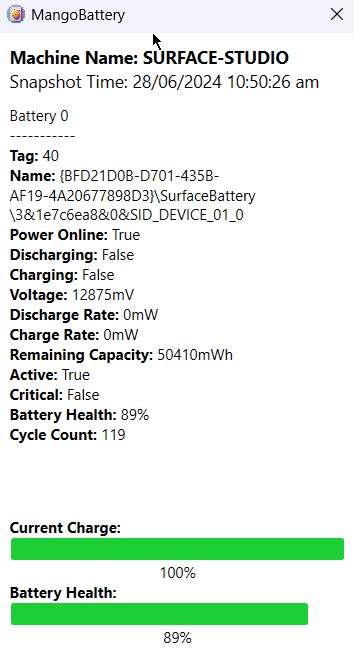

# MangoBattery

[](https://www.microsoft.com/windows)
[](https://dotnet.microsoft.com/)
[](https://github.com/dmitryporotnikov/MangoBattery/releases/latest)
[](LICENSE)

MangoBattery shows the battery numbers that actually matter, without a command line.

On macOS, CoconutBattery gives you cycle count, health and charge rate at a glance. Windows has nothing like it out of the box. `powercfg /batteryreport` will generate a full report, which is more than you need when the only question is whether the battery is holding up.

The app reads the same WMI data and puts it in a small window: current charge, health as full charge capacity against design capacity, cycle count, and whether the machine is charging, discharging or plugged in. There is nothing to configure. Run it.

## Download

The portable, self-contained build is on the [releases page](https://github.com/dmitryporotnikov/MangoBattery/releases/latest). Unzip `MangoBattery-win-x64.zip`, run `MangoBattery.exe`. No installer, no runtime to install.

## Screenshot



## Build

With the .NET 8 SDK:

```bash
dotnet build MangoBattery -c Release -p:Platform=x64
```

The release workflow publishes a self-contained win-x64 ZIP on every push to `main`.

## License

GPL-3.0. See [LICENSE](LICENSE).
